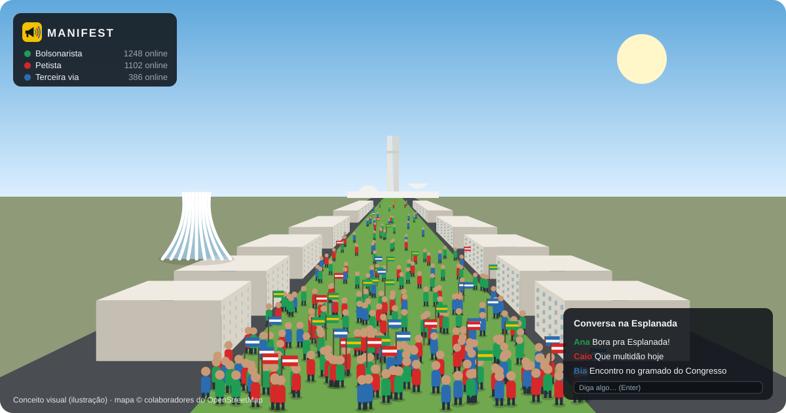
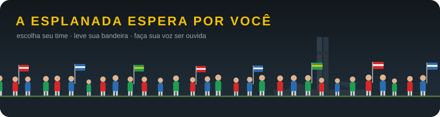

<div align="center">


**Jogo 3D multiplayer no navegador: uma manifestação online na Esplanada dos Ministérios, em Brasília.**


</div>

---

## Pré-visualização

<p align="center">
  
</p>

<p align="center"><sub>Conceito visual (ilustração). Ainda não é uma captura do jogo.</sub></p>

## Sobre o jogo

Escolha seu time, entre com sua conta e vá para a Esplanada:

- **Multidão de verdade:** milhares de pessoas no mesmo mapa. Quem está perto aparece como personagem animado, e quem está longe forma a multidão ao fundo.
- **A Esplanada real:** ruas, ministérios e gramados vêm do OpenStreetMap, e o Congresso Nacional e a Catedral foram modelados à mão.
- **Chat da Esplanada**, com filtro de palavrões e limite de mensagens.
- **Disputa:** PvP, disputa de território entre os times e ranking de influência.
- **Itens especiais**, comprados com moedas via Pix.
- **Só assistir também vale:** sem login, dá para ver a multidão e ler o chat. Para jogar, entre com Google ou com e-mail e senha.

<p align="center">
  
</p>

## Documentação

| Documento | Conteúdo |
|---|---|
| [Spec: núcleo multiplayer](docs/specs/2026-10-16-nucleo-multiplayer-design.md) | Arquitetura, protocolo de rede (JSON + snapshots binários), servidor autoritativo a 20 Hz, área de interesse, mapa do OpenStreetMap, testes |
| [Spec: contas, economia e pay-to-win](docs/specs/2026-10-16-contas-economia-p2w-design.md) | Login (Supabase), moedas via Pix (Woovi), loja e inventário, PvP, território, influência, regras legais |
| [Plano: núcleo multiplayer](docs/plans/2026-10-16-nucleo-multiplayer.md) | As 15 tarefas abaixo, com testes, código e comandos |

## Plano de ação: núcleo multiplayer

O núcleo é o primeiro dos seis subprojetos. As tarefas seguem TDD (primeiro o teste que falha, depois o código), e cada uma termina num commit próprio.

| # | Tarefa | Entrega | Status |
|---|---|---|---|
| 1 | Base do projeto | `package.json`, TypeScript, Vite, Vitest, constantes, times, projeção geográfica | ✅ |
| 2 | Protocolo | Mensagens JSON validadas e snapshots binários PERTO/LONGE | ✅ |
| 3 | Movimento e colisão | Passo de movimento compartilhado e colisão com prédios | ✅ |
| 4 | Grade de interesse | Quem está perto (64) e longe (1000) de cada jogador | ✅ |
| 5 | Mundo | Jogadores, fila de inputs, anti speed hack, retomada em 30 s | ✅ |
| 6 | Chat | Filtro, intervalo, histórico e log de 7 dias sem IP | ✅ |
| 7 | Autenticação | JWT do Supabase, perfis e login de desenvolvimento | ✅ |
| 8 | Proteções de rede | Limite de taxa, conexões por IP, IP via Cloudflare, Origin | ✅ |
| 9 | Sessões | Join autenticado, snapshots, lobby, lotação, timeouts | ✅ |
| 10 | Servidor completo | HTTP + WebSocket, métricas e teste de integração | ✅ |
| 11 | Mapa da Esplanada | OpenStreetMap → `shared/map.json`, com Congresso e Catedral | ✅ (mapa esquemático provisório) |
| 12 | Rede do cliente | Interpolação, predição com reconciliação, reconexão | ✅ |
| 13 | Cena 3D | Mapa, marcos, avatares animados, multidão, câmera | ✅ |
| 14 | Interface e jogo | Lobby, chat, HUD, controles (WASD e joystick) e o jogo funcionando de ponta a ponta | ✅ |
| 15 | Teste de carga | 1000 bots: tick p95 < 25 ms e tráfego dentro da meta | ⚠️ |

Legenda: ⏳ não iniciada · 🔄 em andamento · ✅ concluída · ⚠️ concluída com desvio registrado

### Como o plano pode ser executado

**1. Um agente por tarefa (Subagent-Driven)**
- Cada tarefa vai para um agente novo, que recebe só o contexto daquela tarefa (arquivos, interfaces, testes e código).
- Ao fim de cada tarefa, o resultado passa por duas revisões antes de seguir para a próxima: aderência à spec e qualidade do código.
- **Vantagens:** rápido; cada tarefa é revisada isoladamente; um erro não contamina as próximas.

**2. Execução na mesma sessão (Inline)**
- As tarefas são executadas em sequência na mesma conversa, em lotes, com pontos de parada para revisão humana.
- **Vantagens:** acompanhamento passo a passo, e dá para ajustar o rumo no meio do lote.

> **Forma escolhida:** um agente por tarefa (Subagent-Driven).
> **Situação:** as 15 tarefas foram executadas. Pendências:
> - **Tarefa 11:** o Overpass (OpenStreetMap) estava inacessível no ambiente de desenvolvimento, então `shared/map.json` vem de um mapa esquemático aproximado (`npm run map:esquematico`). Rode `npm run map` com acesso à internet para gerar o mapa real.
> - **Tarefa 15:** com 1000 bots o tick ficou em p95 165 ms (meta: 25 ms). O perfil aponta `sendSnapshots` (seleção de interesse e um envio por cliente por tick) como o gargalo; detalhes no commit da tarefa.

## Demonstração na Vercel

A Vercel não mantém um servidor WebSocket. Por isso o deploy lá usa `npm run build:demo`: o servidor do jogo roda dentro do navegador, com 300 pessoas simuladas, e cada visitante vê a sua própria Esplanada. O jogo multiplayer de verdade precisa do servidor Node (`npm run build && npm start`) num host que aceite WebSocket.

- Projeto: `manifest` (time corrar's projects), ligado a este repositório
- URL: https://manifest-delta-five.vercel.app (protegida pela autenticação da Vercel até o lançamento público)

## Roadmap

| # | Subprojeto | Status |
|---|---|---|
| 1 | Núcleo multiplayer: mapa, andar com outros jogadores, chat, espectador | Implementado (ver pendências) |
| 2 | Contas: Google, e-mail/senha, perfil | Especificado |
| 3 | Economia: moedas, Pix, loja, inventário | Especificado |
| 4 | PvP | Regras e catálogo definidos |
| 5 | Território | Regras e catálogo definidos |
| 6 | Influência | Regras e catálogo definidos |

## Stack

- **Cliente:** Vite + Three.js, com interface em HTML/CSS puro
- **Servidor:** Node 24 (TypeScript direto, sem build) + `ws`, num único processo que serve o jogo, a API e o WebSocket
- **Contas e banco:** Supabase (Auth + Postgres)
- **Pagamentos:** Pix via Woovi
- **Testes:** Vitest (unitários e integração) e bots de carga

## Estrutura

```
shared/   protocolo, constantes, times, movimento, colisão e mapa (cliente e servidor)
server/   servidor do jogo e API HTTP
client/   jogo no navegador
tools/    gerador do mapa (OpenStreetMap) e bots de teste de carga
docs/     especificações, planos e imagens deste README
```

## Serviços necessários

- Projeto no **Supabase**
- Credenciais OAuth no **Google Cloud Console**
- Conta na **Woovi** para receber Pix
- Serviço de e-mail (ex.: **Resend**) com domínio próprio

As chaves ficam em variáveis de ambiente (`.env`) e nunca entram no repositório.

## Avisos

- **Período eleitoral:** o lançamento público fica para depois do 2º turno (25/10/2026), para o jogo não ser enquadrado como propaganda eleitoral.
- **Validação jurídica antes do lançamento:**
  - ECA Digital (Lei 15.211/2025): o jogo não tem caixas de recompensa aleatórias;
  - direito de arrependimento (art. 49 do CDC);
  - emissão de nota fiscal.

## Créditos

- **Mapa:** © colaboradores do [OpenStreetMap](https://www.openstreetmap.org/copyright), licença ODbL.
- **Personagem provisório:** "RobotExpressive", de Tomás Laulhé (Quaternius), licença CC0 1.0.
- **Imagens deste README** (logo, conceito visual e animação): feitas para o projeto, em SVG, em [`docs/assets`](docs/assets).
